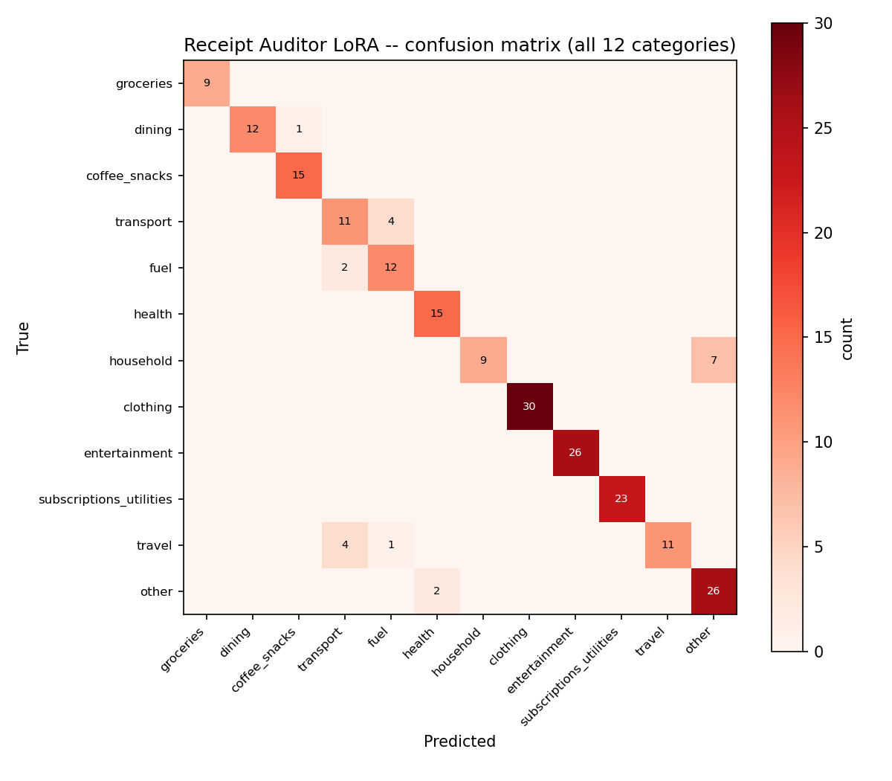

# Receipt Auditor: a finance app where the model never does the arithmetic

A Qwen2.5-1.5B model with a LoRA adapter, trained on a laptop, puts receipt line items into one of 12 spend categories at 90.5% top-1 accuracy on a held-out test set. Claude, asked the same question zero-shot, scored 56.0%. That gap is probably smaller than it looks, and a good part of this write-up is about why. I found the reasons by reading the raw outputs row by row, well after the headline number was published.

Design and copy follow [these standards](https://github.com/lyhjeremy/lyhjeremy/blob/main/DESIGN_STANDARDS.md).

The app around the classifier turns photographed receipts into reconciled, categorized spending, and every number the user sees comes from code. A chatbot handed a pile of receipts and asked what you spent on dining last month has two chances to be wrong: reading the numbers and adding them up. Receipt Auditor takes away the second one. Totals are reconciled against the printed total in Python, spending questions are answered by pandas, and the model only phrases a number it was handed, with a guard checking that the number came through unchanged.

It is one of four apps that each fine-tune a small local model and benchmark it against Claude. The others are [Cellar Scanner](https://github.com/lyhjeremy/cellar-scanner), [Race Day Copilot](https://github.com/lyhjeremy/race-day-copilot) and [Menu Decoder](https://github.com/lyhjeremy/menu-decoder).

## The classifier and the benchmark

Given a merchant string and a line-item description, the model predicts one of 12 categories: groceries, dining, coffee_snacks, transport, fuel, health, household, clothing, entertainment, subscriptions_utilities, travel and other.

`scripts/gen_line_items.py` generated 4,799 synthetic line items with `claude -p`. They vary the abbreviation styles that point-of-sale systems print (`SBUX #4821`, `WM SUPERCENTER #2847`, `TST* JOE'S PIZZA`) and also include full readable names and generic local shops. `training/prep_categorizer.py` splits by merchant instead of by row, so no merchant has items on both sides: 2,537 merchants and 4,309 rows in train, 128 and 270 in validation, 158 and 220 in test. The leakage check passed (`eval/dataset_card.json`).

Training used the same settings as the other apps in the series: LoRA on Qwen2.5-1.5B-Instruct (4-bit) with MLX on Apple Silicon, batch 4, 12 layers, 800 iterations, learning rate 1.5e-4. Validation loss fell from 5.085 to 0.419 (`eval/loss_curve.png`).

All three systems got the same prompt, merchant plus item with no category list, which is the format the LoRA model was trained on. Base and LoRA ran on all 220 test rows; Claude ran on the first 150 after a seeded shuffle.

| System | N | Top-1 | Macro-F1 | Latency | Cost/1k calls |
|---|---|---|---|---|---|
| Base Qwen2.5-1.5B | 220 | 27.7% | 0.333 | 5.0 s | $0 |
| Qwen2.5-1.5B + LoRA | 220 | **90.5%** | **0.893** | 4.5 s | $0 |
| Claude, zero-shot | 150 | 56.0% | 0.506 | 17.7 s | Max subscription |

Fine-tuning took the base model from 27.7% to 90.5%, a 3.3x lift. The LoRA model is also about four times faster than a `claude -p` call and costs nothing per call.

  

The LoRA model's largest errors are household called other (7 times), travel called transport (4) and transport called fuel (4), then other called health (2) and fuel called transport (2). Household and other overlap on generic home goods; travel, transport and fuel overlap on anything involving a car.

## How far to trust the 34.5-point gap

Going back through `eval/raw_outputs.json`, I found four problems with the comparison. The first two mean the table undercounts Claude; the other two make the Claude column harder to read in either direction.

The labels are noisy. They came from the same generator as the training data and aren't consistent: a first-aid kit and cold-relief caplets from CVS are both labeled `other`, a Starbucks latte is `dining`, and Shell unleaded is `fuel` on one test row and `transport` on another. The LoRA model learned those habits. Claude answered `health`, `coffee_snacks` and `fuel`, which a person would mostly accept, and was marked wrong.

The scoring probably undercounts Claude. Claude answered in full sentences, so a script had to pick one category out of each answer, and 83 of the 150 answers mention more than one. The original script's rule is lost (see below). The reconstruction takes the longest category name in the answer, and on an answer such as "would fall under the **`health`** category ... distinct from `household` or `other`" it picks `household`, the category Claude was ruling out.

Claude saw the category list anyway. The prompt had none, but `claude -p` ran from inside the repo with file access, and 101 of its 150 answers cite `src/schemas.py`. Most of the Claude column is contaminated in that sense. Menu Decoder hit the same problem and fixed it by running the CLI from a scratch directory; this benchmark has not been rerun that way.

The scoring script is a reconstruction. The script that produced `eval/benchmark.md` was lost before it was committed, and `training/bench_categorizer.py` was rebuilt against the stored raw outputs. It reproduces the LoRA figure exactly, because those outputs are single category names, and it reproduces the test-set order exactly, because the confusion pairs match. For base and Claude, whose outputs are prose, it gets about 26% and 51% against the published 27.7% and 56.0%.

There is also no test on receipts from outside the generator. The spec calls for 10 to 20 of my own receipts, photographed and hand-labeled, and none have been added. Since Claude both labeled the training data and is a column in the benchmark, a test on the same synthetic distribution can't rule out that receipts from a wallet are harder. Until that set exists, every figure here is about synthetic data.

What the result does support is narrower: a 1.5B model with a small adapter learns a fixed 12-label scheme well enough to replace a frontier-model call for this step, at a quarter of the latency and no per-call cost.

## Reading a receipt without a vision API

I first planned the project around Gemini's vision API. The two API keys I tested in the first session both authenticated but had no free-tier quota provisioned, a project-configuration problem on Google's side (a rate limit would have looked different). Instead of waiting on a third key, I made extraction local: `tesseract` reads the photo, and then one `claude -p` call on my Claude subscription checks that the text is a receipt and pulls structured fields. It refuses photos that aren't receipts and flags low-confidence reads.

## Where the numbers come from

For each receipt, the app adds the line items and tax and compares the sum with the printed total, with a tolerance of the larger of 2 cents or 0.5% of the total. A mismatch is shown flagged for a one-tap correction; nothing adjusts a total to make it agree.

Spending questions follow the same rule. "How much did I spend on dining" is parsed into a structured `Query` (metric, category, merchant, date range) and answered by pandas. The LLM sees the question and the final number, never the dataframe, and writes one sentence. `assert_numbers_present` then checks that every number it was given appears in that sentence, within a cent: "$42" matches "$42.00", and a changed value fails. If a number was dropped or altered, the app shows a template sentence instead. Since the model never produces the total, a made-up total has no way to reach the screen. Asking the same question twice hits a semantic cache and skips the parse and phrasing calls.

## Four places personal data gets stopped

The `Receipt` and `LineItem` schemas have no fields for cardholder name, card number, address or loyalty ID, so extraction never asks for them. Only the validated `Receipt` object survives extraction; the raw OCR text is not cached, logged or stored. Before anything is cached or stored, `privacy.sweep_receipt` runs a regex pass over every merchant and item string, masks long digit runs to the last four, turns emails and phone numbers into `[redacted]`, and reports how many redactions it made. And `privacy.is_space_environment()` is the single check both the local and hosted paths use for persistence: on a hosted Space, receipts live in memory for the session and nothing is written to disk, while locally a git-ignored ledger is opt-in.

## Smaller things that went wrong

The tests caught two bugs before anything shipped. A field named `date` on the `Receipt` schema risked shadowing Python's `datetime.date`, which breaks Pydantic model construction when both names are in the same scope. The narration guard's number regex could also match a bare comma left after a number (`"...$120.00, up from..."`) and crash on `float("")`; a test sentence with several comma-separated numbers caught that one. Both are fixed, and 19 tests pass across reconciliation, privacy and analysis.

The first benchmark run hit repeated 90-second timeouts on `mlx_lm.generate` calls that normally take a few seconds. System load (`uptime`, then `ps aux` sorted by CPU) showed two unrelated VS Code helper processes at 97% and 65% CPU on a 10-core machine. Raising the subprocess timeout to 240 seconds let the run finish with no code changes.

A training log came out empty. `train.sh` pipes through `tee` to `training/adapters/train.log` for the loss-curve script, but the file was 0 bytes even though training finished, probably because the folder is synced by Google Drive. The same output had gone to an outer run log through a different redirect, and the loss curve was rebuilt from that.

The lesson I'd keep from this project is the one in the section on the gap: read the raw outputs before trusting a benchmark. The noisy labels, the scoring problem and the schema leak all showed up only when I read `eval/raw_outputs.json` line by line.

---

Built by [Jeremy Lee](https://github.com/lyhjeremy). Code, benchmark and dataset card: [github.com/lyhjeremy/receipt-auditor](https://github.com/lyhjeremy/receipt-auditor).
